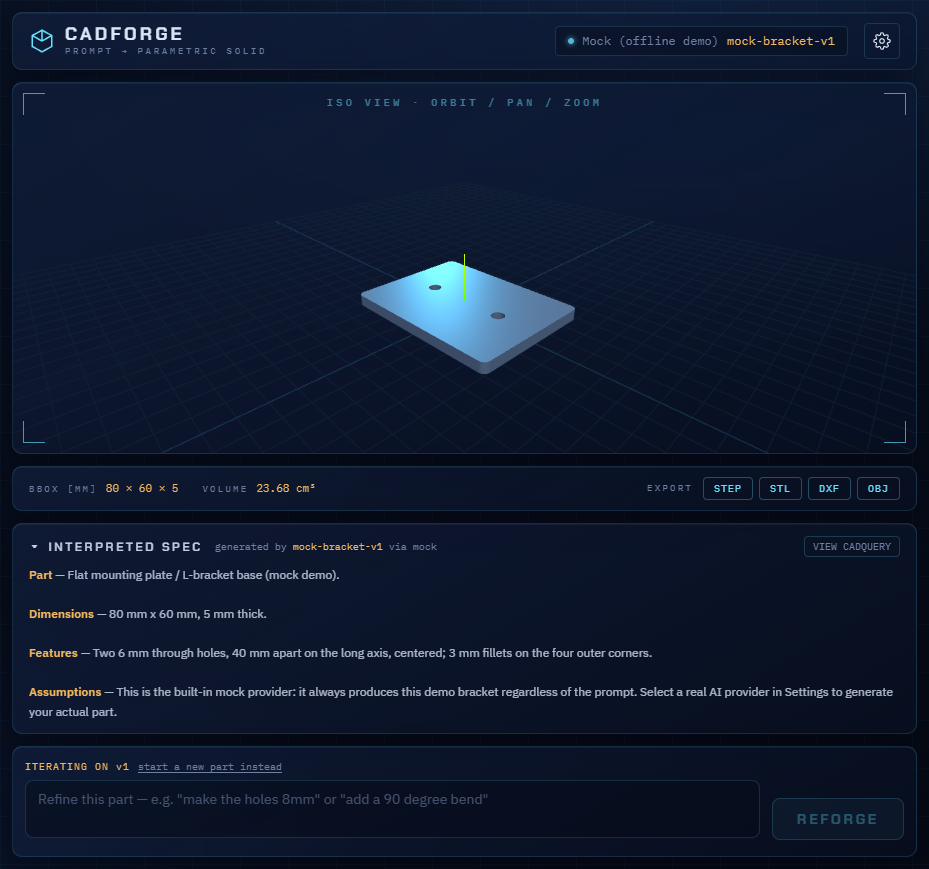
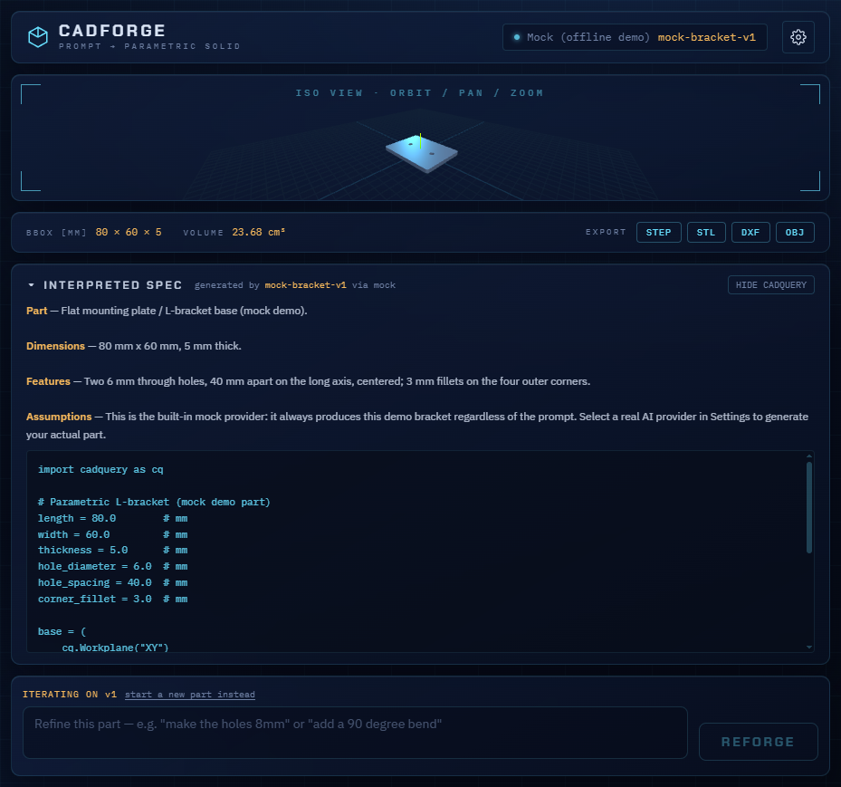
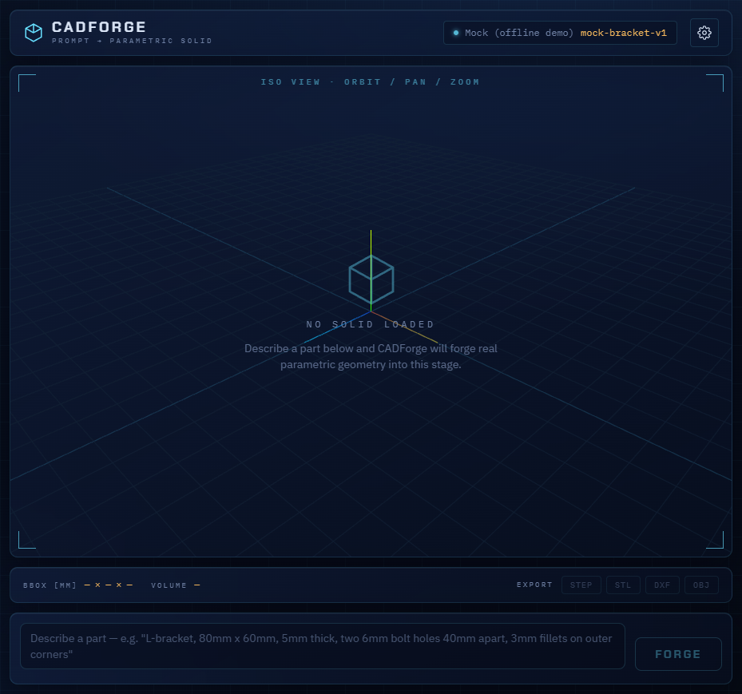

<br/>

**CADForge** turns a plain-English description of a mechanical part into real parametric geometry. Type a prompt, press **FORGE**, and the pipeline normalizes your request into a structured spec, has an AI model write [CadQuery](https://cadquery.readthedocs.io/) (Python) code, executes it in a sandboxed subprocess against **OpenCASCADE**, previews the solid in a Three.js viewport, and exports **STEP / STL / OBJ / DXF**. Follow-up prompts edit the existing code incrementally, with full version history per part.

---

## Screenshots

<table>
<tr>
<td width="50%" valign="top">

### 3D Viewport + Spec Card


Orbit, pan, and zoom the solid. The interpreted spec shows exactly what the AI understood — dimensions, features, assumptions.

</td>
<td width="50%" valign="top">

### Generated CadQuery Code


Every part is backed by real parametric Python. Click **VIEW CADQUERY** to inspect or copy the generated code at any revision.

</td>
</tr>
<tr>
<td width="50%" valign="top">

### Empty Stage


Start with any part description. The mock provider works offline with no API key — great for testing the full pipeline end-to-end.

</td>
<td width="50%" valign="top">

### Provider Settings


Paste an API key, hit **TEST**, pick a model, and set it as default. Keys stay in your browser's localStorage — never sent to a server.

</td>
</tr>
</table>

---

## Requirements

| | |
|---|---|
| Python | 3.10 – 3.12 (3.11 recommended) |
| Node.js | 18+ with npm |
| OS | Windows, macOS, Linux |

---

## Setup

### 1. Backend — FastAPI + CadQuery

```powershell
cd backend
python -m venv .venv
.venv\Scripts\pip install -r requirements.txt        # Linux/macOS: .venv/bin/pip
```

> The CadQuery/OpenCASCADE wheel is ~150 MB — first install takes a few minutes.

### 2. Frontend — React + Three.js + Tailwind

```powershell
cd frontend
npm install
```

---

## Run

```powershell
# Terminal 1 — backend on :8000
cd backend
.venv\Scripts\python -m uvicorn app.main:app --port 8000

# Terminal 2 — frontend on :5173
cd frontend
npm run dev
```

Open **http://localhost:5173**. On Windows, double-click `run-backend.cmd` and `run-frontend.cmd` in the repo root instead.

---

## First flight — no API key needed

The built-in **Mock (offline demo)** provider is selected by default. Type anything and press **FORGE** to run the full pipeline — spec → code → geometry → preview → exports — with a demo L-bracket.

To generate real parts, open **Settings ⚙**:

1. Pick a provider tab, paste your API key, press **TEST**.
2. Optionally press **FETCH MODELS** and choose a model.
3. Set as **Default provider** and save.

| Provider | Key | Default model |
|---|---|---|
| Claude (Anthropic) | `sk-ant-…` | `claude-sonnet-4-6` |
| OpenAI | `sk-…` | Chat Completions |
| Codex (OpenAI) | `sk-…` | Responses API, `gpt-*-codex` |
| GLM (Zhipu AI) | Zhipu key | `glm-4.6` |
| NVIDIA NIM | `nvapi-…` | curated + fetchable list |
| Ollama (local) | none | `http://localhost:11434` |

---

## Using it

**Prompt** — describe the part in plain English:
> *"L-bracket, 80 mm × 60 mm, 5 mm thick, two 6 mm bolt holes 40 mm apart, 3 mm fillets on outer corners"*

The interpreted spec appears above the prompt so you can see what the AI understood. **VIEW CADQUERY** shows the generated code.

**Iterate** — with a part loaded, the next prompt edits the *existing* code:
> *"make the holes 8 mm"* or *"add a 90 degree bend"*

Each iteration is saved as a new revision. Switch between them with the `v1 v2 …` chips in the readout strip.

**Export** — STEP / STL / OBJ always available. DXF appears when a planar cross-section can be taken. Buttons are grayed out until a valid solid exists.

**Archive** — the left rail lists every generated part with thumbnail, model, prompt, and age. Click to reload, ✕ to delete.

**Self-correction** — if generation fails, the error is fed back to the model for an automatic retry (default: 2 retries, configurable in Settings).

---

## Architecture

```
frontend/         Vite + React + Tailwind v4 + Three.js
backend/
  app/providers/  Claude · OpenAI · Codex · GLM · NVIDIA · Ollama · Mock
                  raw HTTPS only — no vendor SDKs
  app/pipeline.py normalize → generate/edit → execute → self-correct → save
  app/sandbox/    subprocess harness: network off, temp cwd, hard timeout
  app/storage.py  SQLite history + files under backend/data/parts/
```

Generated code runs in a separate Python process with `-I` (isolated mode), credential env vars stripped, in-process sockets disabled, and a hard timeout (default 90 s). Geometry is validated with OpenCASCADE `isValid()` before any export.

---

## Tests

```powershell
cd backend
.venv\Scripts\python -m pytest tests -q
```

Covers sandbox execution and exports, failure classification (syntax, geometry, timeout, no-result), the network block, code-fence extraction, storage, and the full pipeline via the mock provider — no API keys needed.
