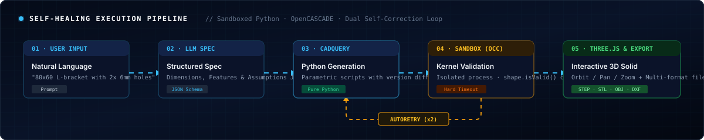
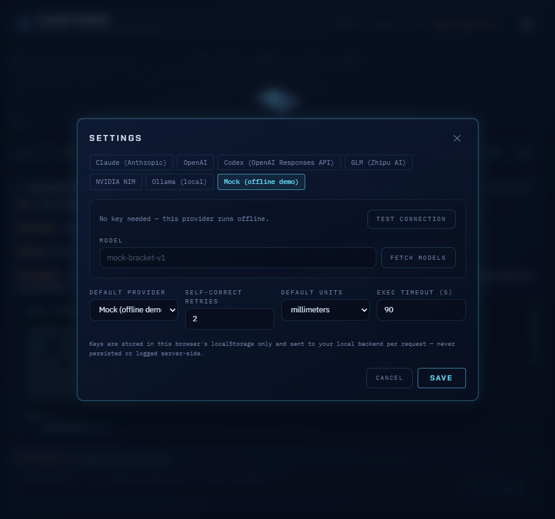

<div align="center">


<p align="center">
  <b>Transform natural language specifications into verified, parametric 3D CAD solids in seconds.</b>
</p>

<p align="center">
  <a href="#key-features"></a>
  <a href="#key-features"></a>
  <a href="#quickstart"></a>
  <a href="#supported-ai-engines"></a>
  <a href="#supported-export-formats"></a>
  <a href="LICENSE"></a>
</p>

</div>

---

## ⚡ Overview

**CADForge** bridges the gap between conversational AI and high-precision mechanical engineering. Rather than synthesizing coarse polyhedral meshes or point clouds, CADForge interprets plain-English requests into structured geometric constraints, generates production-grade [CadQuery](https://cadquery.readthedocs.io/) Python code, executes it inside an isolated subprocess against **OpenCASCADE**, previews the solid in real-time with Three.js, and exports industry-standard **STEP / STL / OBJ / DXF** CAD files.

### 🔄 The Generation Pipeline



1. **Structured Interpretation**: Normalizes ambiguous human prompts into strict dimensions, geometric features, and engineering assumptions.
2. **Parametric Scripting**: Synthesizes clean CadQuery Python code adhering to strict CSG (Constructive Solid Geometry) principles.
3. **Sandboxed Execution**: Runs in an isolated subprocess (`-I` mode, network disabled, credential scrubbing, hard timeouts).
4. **Autonomous Self-Correction**: If syntax, geometric kernel exceptions, or validation checks fail (`shape.isValid()`), error traces are fed back to the model for automatic healing (up to 2 retries).
5. **Interactive 3D Stage & Exports**: Renders the resulting solid in Three.js with orbit/pan/zoom, inspection tooling, and immediate download.

---

## 📸 Interface Tour

<table>
<tr>
<td width="50%" valign="top">

### 1. Interactive 3D Viewport & Spec Cards


Inspect generated solids with real-time orbit, pan, and lighting controls. The bottom panel breaks down the AI's interpreted dimensions, features, and assumptions with complete transparency.

</td>
<td width="50%" valign="top">

### 2. Live Parametric CadQuery Inspector


Inspect, copy, or adapt the exact Python CadQuery code behind the model. Follow-up revisions maintain history chips (`v1`, `v2`, `v3`) for seamless incremental modifications.

</td>
</tr>
<tr>
<td width="50%" valign="top">

### 3. Immediate Zero-Config Playground


Ships with a built-in offline **Mock Provider** enabled by default. Test and explore the complete end-to-end pipeline without needing an API key or internet access.

</td>
<td width="50%" valign="top">

### 4. Client-Side Secure Provider Manager


API keys stay strictly inside your browser's `localStorage` and are sent transiently over HTTPS per request—never logged, persisted, or saved on any server.

</td>
</tr>
</table>

---

## 🚀 Quickstart

### Prerequisites

| Component | Minimum Version | Recommended | Notes |
|---|---|---|---|
| **Python** | `3.10` | `3.11` | Required for CadQuery & OpenCASCADE |
| **Node.js** | `18.0+` | `20.x LTS` | Frontend UI & Three.js runtime |
| **OS** | Windows, macOS, Linux | Windows 10/11 or Ubuntu | Native OpenCASCADE binary wheels available |

---

### Step 1: Backend Setup (FastAPI & CadQuery)

```bash
# 1. Enter backend directory
cd backend

# 2. Create and activate a Python virtual environment
# Windows (cmd/PowerShell):
python -m venv .venv
.venv\Scripts\activate

# Linux / macOS:
# python3 -m venv .venv
# source .venv/bin/activate

# 3. Install CadQuery and dependencies (~150MB OpenCASCADE wheel)
pip install -r requirements.txt
```

### Step 2: Frontend Setup (React, Three.js & Tailwind v4)

```bash
# In a new terminal window:
cd frontend
npm install
```

### Step 3: Run the Development Stack

```bash
# Terminal 1 — Backend API (port 8000)
cd backend
.venv\Scripts\python -m uvicorn app.main:app --port 8000 --reload

# Terminal 2 — Frontend App (port 5173)
cd frontend
npm run dev
```

> **Windows Quick Launch**: You can also simply double-click `run-backend.cmd` and `run-frontend.cmd` in the repository root.

Visit **[http://localhost:5173](http://localhost:5173)** in your browser!

---

## 🤖 Supported AI Engines

CADForge provides a unified, direct HTTPS provider layer with zero third-party vendor SDK bloat:

| Engine / Provider | Key Type | Supported Features | Default Model |
|---|---|---|---|
| **Mock (Offline Demo)** | *None required* | Instant testing, full pipeline preview | Built-in L-Bracket Demo |
| **Anthropic Claude** | `sk-ant-...` | Deep reasoning, complex geometric CSG | `claude-sonnet-4-6` |
| **OpenAI** | `sk-...` | Fast code generation via Chat Completions | `gpt-4o` |
| **OpenAI Codex** | `sk-...` | Code-specialized synthesis via Responses API | `gpt-4o-mini` |
| **GLM (Zhipu AI)** | *Zhipu API Key* | High efficiency code generation | `glm-4.6` |
| **NVIDIA NIM** | `nvapi-...` | Curated accelerated cloud models | Llama 3 70B Instruct / Mistral |
| **Ollama (Local)** | *None required* | 100% private local inference (`localhost:11434`) | `deepseek-coder`, `codellama` |

---

## 💡 Prompting & Incremental Iteration

CADForge is designed for iterative, conversation-driven mechanical modeling:

### 1. Initial Prompt
> *"L-bracket, 80 mm long, 60 mm high, 5 mm thickness. Add two 6 mm counterbored bolt holes spaced 40 mm apart on the horizontal base, and 3 mm fillets on outer edges."*

### 2. Conversational Iteration
Each prompt with an active model refines the existing CadQuery code while creating a new revision chip (`v1` → `v2` → `v3`):
> *"Increase the bolt hole diameter to 8 mm and chamfer the vertical top edges by 2 mm."*

---

## 🛡️ Sandbox Security Architecture

Running AI-generated Python code requires strict isolation. CADForge implements multi-tiered containment:

```
[ Incoming Request ]
         │
         ▼
[ Isolated Subprocess (python -I) ]
   ├── In-process socket refusal patch (No outbound networking)
   ├── Environment isolation (credential env vars scrubbed)
   ├── Transient scratch directory per build
   ├── Hard Execution Timeout (Default: 90 seconds)
   └── Kernel Geometry Validation (shape.isValid() prior to export)
```

---

## 🧪 Testing

Run the automated test suite covering sandbox security, code fence extraction, failure classification, and export serialization:

```bash
cd backend
.venv\Scripts\python -m pytest tests -v
```

---

## 📄 License

Distributed under the **MIT License**. See `LICENSE` for more information.
